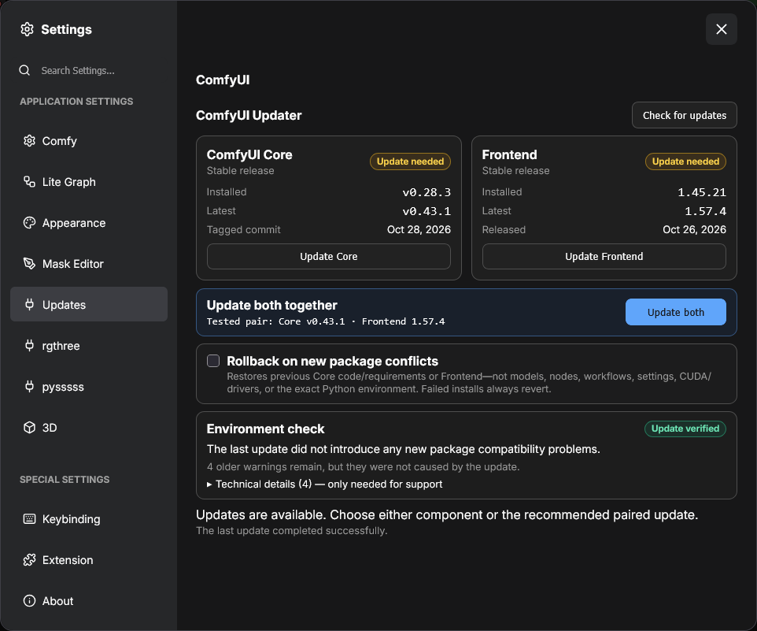

<div align="center">
  
  
  
</div>
<br />

# ComfyUI Updater 🔄

ComfyUI Updater adds a native **Updates** section to ComfyUI Settings. It manages only ComfyUI Core and the official frontend package; it does not inspect, install, or update custom nodes.

## Contents

- [Features](#features)
- [Preview](#preview)
- [Installation](#installation)
  - [Native Extension Manager](#option-1-native-extension-manager-recommended)
  - [Manual installation](#option-2-manual-installation)
- [Update behavior](#update-behavior)
- [Release dates](#release-dates)
- [Recovery](#recovery)
- [Security](#security)
- [Support](#support)
- [Development](#development)
- [License](#license)

## Features

- Separate **Update Core** and **Update Frontend** actions.
- Recommended **Update both** action for the tested Core/frontend version pair.
- Per-component **Up to date** and **Update needed** badges.
- Installed and latest versions with their release dates.
- Compatibility warning and frontend restore action when the installed pair does not match.
- Blocking, restart-aware update screen that keeps the user informed while ComfyUI is unavailable.
- Plain-language environment health check with optional technical details.
- Before/after comparison that distinguishes existing package warnings from problems introduced by an update.
- Recovery branch, requirements snapshot, update log, and rollback before ComfyUI is relaunched.
- Collapsible support module with GitHub, Ko-fi, PayPal, and USDC actions.

## Preview

<p align="center">
  
</p>

## Installation

### Option 1: Native Extension Manager (recommended)

1. Open ComfyUI's native **Extension Manager**, then open **Nodes Manager**.
2. Search for `comfyui-updater` and select **ComfyUI Updater**.
3. Click **Install**, restart ComfyUI when the installation finishes, and hard-refresh the browser once.

Open **Settings → Updates** to use the updater.

### Option 2: Manual installation

Open a terminal in `ComfyUI/custom_nodes/` and clone the repository:

```bash
git clone https://github.com/andreszs/comfyui-updater.git
```

Restart ComfyUI, hard-refresh the browser once, and open **Settings → Updates**.

## Update behavior

- **Update Core** checks out the latest stable ComfyUI tag and installs its non-frontend Python requirements while preserving the installed frontend.
- **Update Frontend** installs the frontend version paired with the latest stable Core while preserving the installed Core.
- **Update both** checks out the latest stable Core and installs its complete pinned requirements. This is the recommended path.
- **Restore compatible Frontend** reinstalls the version required by the currently installed Core.

Core changes require a Git-based ComfyUI installation with an `origin` remote and no tracked local changes. Frontend-only changes do not modify Git.

## Release dates

For Core, the plugin uses the published GitHub Release date when the tag has a release object. If the project publishes only a lightweight tag, the UI explicitly shows the tagged commit date instead. For Frontend, it uses the first non-yanked PyPI upload for the exact target package version. Values are cached after update checks; unavailable remote metadata never blocks an update.

## Recovery

Before an update, the plugin records the environment's existing package compatibility warnings. Before a Core update, the worker also creates a recovery branch and stores the previous requirements.

After installation, the same compatibility check runs again. Existing warnings do not block an update. An optional checkbox can make the worker treat new warnings as a failed update and attempt recovery before relaunching ComfyUI. When disabled, new warnings are reported without reverting the completed update. A Git or package-installation failure is always treated as an incomplete update and triggers recovery.

Recovery returns Core to its previous Git commit and reinstalls the previous Core requirements or Frontend version. It does not restore models, custom nodes, workflows, settings, CUDA, GPU drivers, or an exact copy of every indirect Python package. The Settings panel reports whether recovery was verified, could not be verified, or failed.

This check covers installed Python package requirements. It cannot guarantee CUDA, GPU drivers, native DLLs, models, workflows, or third-party extensions will work at runtime, so the plugin reports this limitation without asking non-technical users to repair packages manually.

Status, cache, and logs are stored under:

```text
ComfyUI/user/default/ComfyUI-Updater/updates
```

## Security

Every boot creates a random update token. Mutation requests require same-origin JSON, the token in a custom header, and one server-selected action. The browser cannot submit Git refs, filesystem paths, packages, or commands.

## Support

If ComfyUI Updater is useful to you, consider [starring the repository](https://github.com/andreszs/comfyui-updater). Stars help other ComfyUI users discover the project.

Financial contributions help cover the tools used to develop, maintain, and test this and other open-source ComfyUI extensions:

- [Ko-fi](https://ko-fi.com/D1D716OLPM)
- [PayPal](https://www.paypal.com/ncp/payment/GEEM324PDD9NC)
- **USDC on Arbitrum One:** `0xe36a336fC6cc9Daae657b4A380dA492AB9601e73`

> [!CAUTION]
> Send USDC using the Arbitrum One network only. Transfers sent through another network may be permanently lost.

## Development

```bash
python -m unittest discover -s tests -v
npm test
npm run lint
```

## License

MIT
